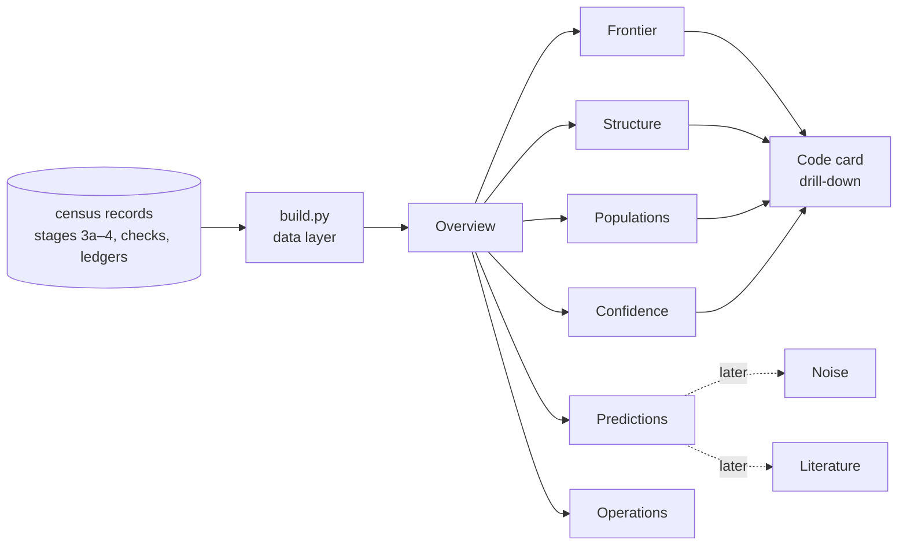

# Census dashboards: a review suite (plan)

**Status:** a plan, written 2026-11-02 while stage 4 is still running. Nothing in it is built
yet, apart from the census explorer (`examples/qec-census-4/explorer/`), which it absorbs. The
decisions that are yours are at the end.

## What the suite is for

It is a set of linked pages for reviewing the code census together. Each page answers one
question:

| # | Question | Page |
|---|---|---|
| 1 | What codes did the census find, and how do they compare with published codes? | Frontier |
| 2 | Why does the frontier look the way it does? | Structure |
| 3 | How rare are the best codes among all the codes on a torus? | Populations |
| 4 | How sure are we of each number? | Confidence |
| 5 | Which registered predictions held, and which failed? | Predictions |
| 6 | Is the current run healthy, and what does a run cost? | Operations |

Two rules hold on every page:
- **Every number traces back to a record.** The trail runs page → dataset → repository file and
  commit.
- **Registered results and exploratory fits never look alike.** Every law or fit carries a
  badge: *registered (held / failed)* or *exploratory*.

## The suite at a glance

| Page | Main panels | Priority |
|---|---|---|
| Overview | headline numbers, prediction scorecard, run status, what changed since the last review | 1 |
| Frontier | d / d/√n / k·d²/n scatter (today's explorer), n×k heat map, trade-off plane, residuals, leaderboard | 1 |
| Code card | one code in full: polynomials, stencil, witness, checks, provenance | 1 |
| Structure | census map (l×m), arithmetic skeleton, group families, stencil gallery | 2 |
| Populations | distribution of d over all classes on a torus, class counts, depth of the top, window tightness | 2 |
| Confidence | tiers per code, instrument agreement matrices, unsettled entries | 3 |
| Predictions | scorecard, laws drawn against the data that tested them, study timeline | 3 |
| Operations | run monitor (burn-up, ETA against the stop rule), cost model | 3, or earlier if wanted while stage 4 runs |
| Noise, Literature | when those studies exist (`examples/qec-noise/PLAN.md`; the novelty check) | later |

## The data layer

The raw records are about 110 MB: roughly 760,000 class rows, plus checks and ledgers. That is
far beyond what a page can load. A build script (`examples/qec-census-4/dashboards/build.py`)
reduces them to small datasets, each stamped with the build time and the git commit it read.

**Sources**, as of 2026-11-02:

| Source | What | Size |
|---|---|---|
| `qec-census-3/data/*.jsonl` | stage 3a: every class on 116 tori with n ≤ 200, each with its exact d and the size of its class (36,496 classes) | 10 MB |
| `qec-census-3b`, `-3c/records.jsonl` | stages 3b/3c: 122 tori, 253,370 classes, each with its window bound; 2,309 exact runs | 38 MB |
| `qec-census-3d/records.jsonl` | the 154 classes re-run with DistQLDPC | 0.3 MB |
| `qec-census-4/records.jsonl` | stage 4 (84 of 110 tori so far): 472,034 classes, 10,435 exact runs with their engine, method and time | 73 MB |
| `qec-census-4/exact-checkpoint.jsonl` | every exact result of stage 4, including those still in progress | 23 MB |
| `qec-census-3b/spotcheck/`, `qec-census-4/check-310/`, `qec-census-4/validation/` | 431 spot-check jobs, the [[310,10,22]] checks, and the instrument validation on 16 tori | 2 MB |
| `*/ledger.jsonl` | 33 registered studies, 11 of them on codes, with their predictions and verdicts | small |
| `qec-bb/codes.json` | published codes | small |
| git history | 54 record commits in stage 4 alone, which give progress over time | — |

**Derived datasets.** Each is well under the 8 MB per-dataset limit.

| Dataset | One row per | Main columns | Rows |
|---|---|---|---|
| `frontier` | (torus, k) frontier entry | l, m, n, group, invariant factors, stage, k, d, settled, A, B, k·d²/n, d/√n, fit residuals, tier | ~650 at the end |
| `tori` | torus | l, m, n, group, isomorphic copies, criterion E and the prime behind it, status (no codes / settled / unsettled / exposed / pending), classes, orbit reps, timings, exact runs | ~350 |
| `class_hist` | (torus, k, kind, value) | the counts of exact d (complete for stage 3a) and of window bounds (stages 3b–4) | ~20k |
| `classes_3a` | stage 3a class | torus, k, d, class size, connected | 36,496 |
| `runs` | exact run | stage, torus, k, d, engine (packing search / DistQLDPC cluster / MaxSAT / parity / small-weight), seconds | ~20k |
| `checks` | (code, check) | spot-check C1–C6, stage 3d, the [[310,10,22]] checks, validation: result, consistent, reaches d, seconds | ~700 |
| `codes` | headline code | tier, witness, provenance (file, line, sha256), nearest published code | ~100 |
| `stencils` | (code, monomial) | the monomials of A and B under the embedding with the smallest diameter | ~600 |
| `predictions` | registered prediction | study, part, text, registered time, verdict, deciding datum | ~70 for codes, ~1,300 for the whole lab |
| `fits` | law or fit | formula, constants, registered or exploratory, source | ~10 |
| `progress` | records commit | run, time, tori done | ~60 per run |

**Tests**, run before any dataset ships:
- the counts reconcile with the records: 533 frontier entries today, and every torus once;
- isomorphic tori are flagged consistently;
- the known codes are present with their published values. Examples: [[310,10,22]] on 5×31;
  the spot-check tiers of 1 certified, 9 second method and 10 second implementation; the 154
  classes of stage 3d at d = 24;
- the frontier matches the explorer's current data exactly.

**Refresh.** Snapshots are rebuilt with `build.py` and re-attached on demand, or at each run
check-in. Every page shows how old its data is.

## The pages

### Overview (home)

- **Headline numbers:**
  - tori computed and the share settled;
  - classes, and distinct codes after merging isomorphic tori;
  - the census's best k·d²/n set against the best published code at or below the same n;
  - the run's status: for example "stage 4: 84 / 110 tori, finish expected Nov 4–5, stop rule
    Nov 13".
- **Prediction scorecard:** the census's registered predictions counted as held, failed,
  incomplete or pending, by stage. Each count links to Predictions.
- **What changed since the last review:** new frontier entries, new census records, and
  verdicts since a date you pick.

### Frontier

1. **The scatter.** Today's explorer, carried over: d, d/√n or k·d²/n against n. It has toggles
   for the registered laws and the exploratory fits, and shows published codes as diamonds.
   Clicking a point selects the torus everywhere on the page.
2. **The n × k heat map.** n across, k down (even values), and the cell colour is the best d on
   a single-hue sequential scale. The colour can be switched to k·d²/n or to the residual. Cells
   where the census matches or beats a published code are outlined. This is the densest single
   view: k layers show as bands, impossible (n, k) show as gaps, and the k comb set by the
   group's primes shows as stripes.
3. **The trade-off plane.** k against d, with one panel per 50 qubits of n. It draws curves of
   constant k·d²/n (10, 13.5, 15 and 19.2, each labelled), the census frontier as a step line,
   and the published codes. It shows where the census beats, matches or trails the literature.
4. **Residuals.** Two plots: d minus the fitted edge against n for the k = 4 tops, and d minus
   (2.31·n^0.443 − k) against n for every point. Taking the trend out exposes what is left: the
   staircase, the dip at n = 312, and groups that run consistently high (the gross-code type, k
   = 12) or low.
5. **The leaderboard.** A sortable table with a tier icon on each code. Clicking a code opens its
   code card.

**Filters**, which apply to every panel on the page: stage; n range; k; group type (cyclic /
non-cyclic / with a Z2×Z2 or Z3×Z3 part); and whether to merge isomorphic tori.

### Code card (a drill-down from any code)

- [[n,k,d]], the torus, its group, and the isomorphic tori that carry the same code;
- A and B written as polynomials, and drawn as a stencil on the torus grid;
- the minimum-weight witness drawn on the grid;
- k·d²/n and d/√n;
- the tier and every check, each as a chip;
- the torus's d-against-k profile, and the nearest published code;
- provenance: the file and line of each record, and the sha256 of the code that produced it.

### Structure

1. **The census map.** A grid of l (up) against m (across), one cell per torus, coloured by
   status: no codes (criterion E false), settled, unsettled, exposed, or pending. Faint hyperbolas
   mark lm = 100, 150 and 200, so it shows coverage and the held-out bands at a glance.
2. **The arithmetic skeleton.** A strip along the n axis that marks which n have codes. Each mark
   is coloured by the prime that makes criterion E hold (3, 7, 31, 73 or 85; at most three are
   ever shown together, the rest folded into "other"), and the k values available at that n are
   stacked as dots. This is the exact skeleton behind the "comb" look: d is even, codes exist
   only where 3, 7, 31, 73 or 85 divides lm, and the k at a column's top is 2·ord_t(2).
3. **Group families.** One row per group, with its invariant factors, the tori that share it,
   its d_max and its set of k. Non-cyclic groups with a Z2×Z2 or Z3×Z3 part are highlighted:
   that is where the gross-type codes and the published [[360,12,24]] live.
4. **The stencil gallery.** Small multiples of the top codes, filtered by score, k or group. Each
   draws A's and B's monomials on the torus grid, under the embedding with the smallest stencil
   (the regularity scripts already compute this). Each caption gives [[n,k,d]] and the stencil
   diameter. This is the panel most likely to reveal a constructive family.

### Populations

1. **The distribution on one torus.** Pick a torus and a k. Stage 3a shows the histogram of exact
   d over every class, optionally weighted by class size. Stages 3b–4 show the histogram of
   window bounds, with the exact d marked for the classes that were run. d_max and d_max − 2 are
   marked.
2. **Class counts against n.** On a log scale, with the observed growth of about n^2.7.
3. **The depth of the top.** The number of classes that reach d_max, and d_max − 2, on each torus
   against n. This is the "lottery or hard edge" question from the regularity analysis.
4. **The bulk against the edge.** The median, 90th percentile and maximum of d at each n, from
   the complete stage-3a data, with their fitted exponents (about 0.68 to 0.71 for the bulk,
   0.63 for a fixed sample size).
5. **Window tightness.** A histogram of the window bound minus the exact d, for classes that have
   both. Also the share of exact runs among all classes on each torus against n, which is what
   the instrument's pruning achieves.

### Confidence

1. **Tiers.** Each headline code, census or published, with its tier and a status chip for every
   check: certified (DRAT proof), second method (MaxSAT, SCIP), second implementation (DistQLDPC's
   cluster engine, the unpruned search), or search only. Status colours always come with an icon
   and a word.
2. **Agreement matrices.** Rows are codes or tori, columns are checks, and each cell is agree /
   contradict / unfinished / error. There is one matrix for each of:
   - the spot-check (20 codes by C1–C6);
   - the stage 4 validation (16 tori, old instrument against new);
   - stage 3d (154 classes);
   - the [[310,10,22]] checks.
3. **Unsettled entries.** Frontier entries that are only lower bounds. It is empty through stage
   3d, and lists stage 4's if any appear.

### Predictions

1. **Scorecard.** Every registered prediction on codes (stages 2, 2b, 3b/3c, 3d and 4, plus the
   distance studies). Each has a status pill and the datum that decided it, for example "P2
   failed at 2×51: [[204,4,20]]".
2. **Laws against data.** Each registered law is drawn over the data that tested it, with the
   violating points labelled. That covers 1.40·√n, 0.801·n^0.607, the ceilings of 13.5 and 17,
   and the exploratory fits, badged as such. The registration date sits beside the stage of the
   data, so it is plain what was known when.
3. **Timeline.** Studies on a time axis: question, run, verdict, from the ledgers. The 11 studies
   on codes by default; all 33 registered studies in the lab if you want them.

### Operations

1. **Run monitor.** A burn-up of tori done against time, from the git history of the record
   commits. It shows the projected finish against the stop rule, the torus in progress, errors,
   unsettled entries, and the pod and its hardware.
2. **Cost model.** Exact-run time against d on a log scale, one series per engine (packing search,
   DistQLDPC cluster, MaxSAT), with the fit of about 8× per +2 in d. Also each torus's wall time
   against n.
3. **Check durations.** How long each kind of check takes, and which kinds time out (C1–C6, and
   SAT at 24 h).
- **Money is not recorded today.** If we want spend on this page, launches should append a line
  to `runs/pods.jsonl` from now on: the pod, its rate, and its start and stop times.

### Later

- **Noise.** The logical error rate per round, per logical qubit, against p, with one curve per
  code, the circuit distances, and the fits (from the noise study).
- **Literature.** Census codes against the published tables: beats, matches or trails, with
  citations (from the novelty check).

## Across all pages

- **Linking.** Clicking a code opens its code card. Clicking a torus selects it on every panel.
  Filters apply to the whole page.
- **Charts** follow the project's dataviz rules:
  - a single-hue sequential scale for magnitudes (d, k·d²/n);
  - at most three categorical colours on any scatter;
  - status colours only for verdicts and tiers, always with an icon and a word;
  - one axis per chart;
  - a tooltip on every chart, and a table view behind each one;
  - both light and dark themes, and readable at phone width.
- **Isomorphic tori** count once in statistics by default, with a toggle to show every torus.

## How to build it

**Option A: the platform's Dashboard page type (recommended).**
- *For it:*
  - every number on the page links to the dataset it came from;
  - you can comment on any chart, which suits reviewing together;
  - it has several pages and filters built in;
  - it styles both themes.
- *Against it:*
  - each page file is at most 256 KB, so the scripts get split into files;
  - each dataset is at most 8 MB, which the data layer already handles;
  - charts are drawn with d3;
  - the type asks me not to render the pages to check them unless you allow it.

**Option B: extend the hand-built explorer into a multi-tab page.**
- *For it:* full control, a single 16 MB page, and I can screenshot-check every view.
- *Against it:* no per-number provenance and no built-in comments.

**Recommendation:** A for the suite. The explorer stays as it is until the Frontier page replaces
it.

## Phases

| Phase | What | My time |
|---|---|---|
| 0 | `build.py`, the datasets and their tests | about ½ day |
| 1 | Overview, Frontier, Code card | about 1 day |
| 2 | Structure (including the stencil computation, minutes locally), Populations | about 1 day |
| 3 | Confidence, Predictions, Operations | about 1 day |
| 4 | Noise and Literature, when those studies exist | later |

Each phase ends with a review round: you look, comment on the pages, and I fix what you flag. No
pods are needed. Everything runs on data already in the repository.

## What the suite does not do

- It starts no new computation, apart from the stencil embeddings and the aggregates.
- It changes nothing in any registered study.
- It makes no claims of novelty until the literature check is done.

## Decisions for you

1. **Platform.** The Dashboard type (recommended), or the hand-built explorer extended?
2. **Checking.** May I render each page to check it? The Dashboard type asks me not to unless you
   say so.
3. **Scope of Predictions.** The 11 studies on codes, or all 33 registered studies in the lab?
4. **Refresh.** Snapshots on demand (the default), or try reading live from the repository
   through the GitHub connector, if your account's connector can read the private repo?
5. **A public version for the site later?** It would carry aggregates only, with no links into
   lattice-lab.
